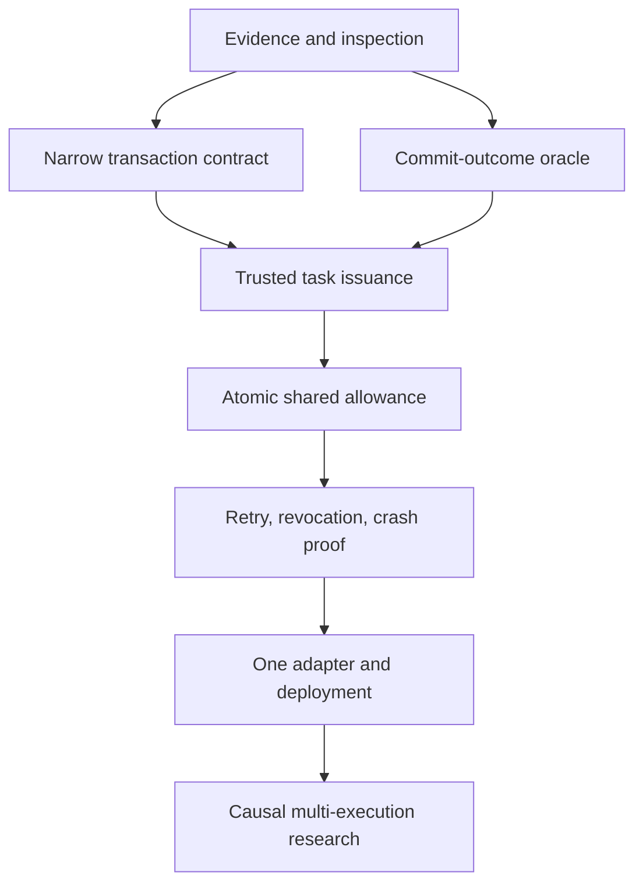

# D — Progressive Feature Roadmap

2026-10-13. **HYPOTHESIS / proposed sequence**, not accepted product planning. [C](C-creative-feature-discovery.md) contains per-feature threat boundaries, implementation ranges, success/negative tests, privileges and maintenance estimates. [E](E-reproducible-security-research-plan.md) defines experiment gates. No weighted scores are used.

## First independently useful capability

**F01: effect-boundary evidence bundle.** Extend the existing generic UPDATE demo into a machine-readable, independently checkable result for its exact restricted-writer environment. The native mechanism already exists; rewriting it would not reduce the biggest immediate risk: misunderstanding what it proves.

Minimum milestone: one clean command reproduces allowed commit, excessive UPDATE denial, sticky denial after savepoint recovery, and **successful cross-transaction splitting as an expected limitation**; an unguarded control must show the excessive write. A fresh trusted connection verifies exact durable state. The report names source SHA, database version/image, policy, writer, scenario, expected boundary, SQL outcome, oracle result and cleanup. No signatures, MCP, task ledger or runtime changes.

Developer utility: compare a new guard/version/adapter with the same failure cases and distinguish a failed test from a known unsupported guarantee. Commercial relevance is indirect; do not charge merely for proof that the prototype works.

## Dependency order and stop gates

| Stage | Ordered work and reuse | Gate before proceeding | Defer/reject conditions |
|---|---|---|---|
| **1 — EASY** | F01 evidence bundle → F02 existing preflight report and F03 strict V0 plan validation → F04 disposable repair replay. F05 benchmark runner is a separate measurement branch after F01. | Independent clean reproduction; disabled/missing guard and missing oracle never appear as enforcement PASS. All output says transaction-local. | Existing demo already adequate: shrink to documentation/reporting. Do not create a new toolchain for formatting alone. |
| **2 — MEDIUM** | F06 installation contract from existing generic guard. F07 RLS/object-scope comparison from F04. F08 transition or F09 numeric generalization only for an explicit useful fixture. F10 commit-outcome resolver branches from F01/F04. | Precise scope and trusted-writer contract; durable positive/negative oracles; unsupported topology rejected. Simpler procedure/RLS baseline compared. | If procedure/constraint/RLS solves the job, ship a reference experiment instead of a novel runtime. Do not generalize both semantic fixtures by default. |
| **3 — HARD** | F11 trusted issuance after F06/F10 → F12 single-database atomic committed-effect ledger → F13 retry binding and F14 admission expiry/revocation → F15 multi-worker/crash composition. | No self-renewal, aggregate overspend, atomicity gap or compensation refill in deterministic adversarial runs. Separate SQL committed-ceiling contract from native sticky denial. | Any counterexample to effect/debit atomicity blocks adapters. If serialized procedure suffices, stop at that boundary. |
| **4 — ADVANCED** | F16 one MCP adapter after core evidence → F17 one causal workflow family. F18 deployment comparison can begin documentary/local research after F06/F12, but provider certification waits for authorization and stable semantics. | Exact-version adapter contract; no alternate credentials; correct UNKNOWN after ambiguity; real provider evidence before support claims. | No universal MCP certification, cross-cloud control plane, multi-database atomicity or general workflow graph in near-term scope. |

These are branches of inquiry, not eighteen mandatory features. F02/F03 can remain subcommands in the existing CLI. F07 may finish as a comparison showing PostgreSQL already solves the requirement. F08 and F09 are alternatives until a workflow requires both.

## Difficulty and maintenance budget

Level 1 is mostly scripts/schema/docs with medium evidence-design difficulty. F01 is roughly **3–6 engineering days**, plus **1–2 independent review/reproduction days** (planning estimate). Level 2 requires security review even when code is small; individual ranges are 4–20 days. Level 3 ranges 10–45 days per candidate and can expose architectural failure rather than a shippable result. Level 4 ranges are exploratory; provider cooperation and distributed causality are not predictable solo-maintainer commitments.

Line counts are intentionally not estimated: shell orchestration versus SQL/C implementation changes the count without measuring risk. Engineering-day ranges in C satisfy implementation sizing while making uncertainty explicit. No production schedule or availability commitment follows from them.

The highest risks are identity renewal, effect/debit atomicity, concurrent serialization, ambiguous commit outcomes, and deployment privilege constraints. A polished UI does not reduce them. Performance is a separate gate and remains inconclusive until controlled reruns; favorable lab latency cannot expand supported semantics.

## Architecture hypothesis, not five products

| Proposed layer | Necessity and disposition |
|---|---|
| Research Core | Keep existing native fixtures and future SQL comparisons in this repository. A distinct security contract is necessary; a distinct commercial product is not. |
| Developer Tools | Extend current CLI/demo/evidence paths. Necessary first utility; separate codebase and paid SKU are unnecessary now. |
| Agent Adapter | Optional after core proof. One integration, versioned envelope, no general gateway. |
| Advanced Authority | Research module/contract only until F12–F15 prove a reusable job. No subscription platform commitment. |
| WooCommerce | Preserve existing product and release boundary. Its Preview/Resume/Undo engine is neither a PostgreSQL extension nor evidence for task-wide authority. |

**INFERRED:** Open comparison fixtures and clear contracts are more defensible than an unverified proprietary safety claim. Repository-wide licensing is still undecided; no license change is made. Paid possibilities are maintained deployment builds, independently reviewed adapter compatibility, integration support and OEM support terms, contingent on adoption and a sustainable support obligation. Do not paywall the evidence necessary to assess an enforcement claim.
