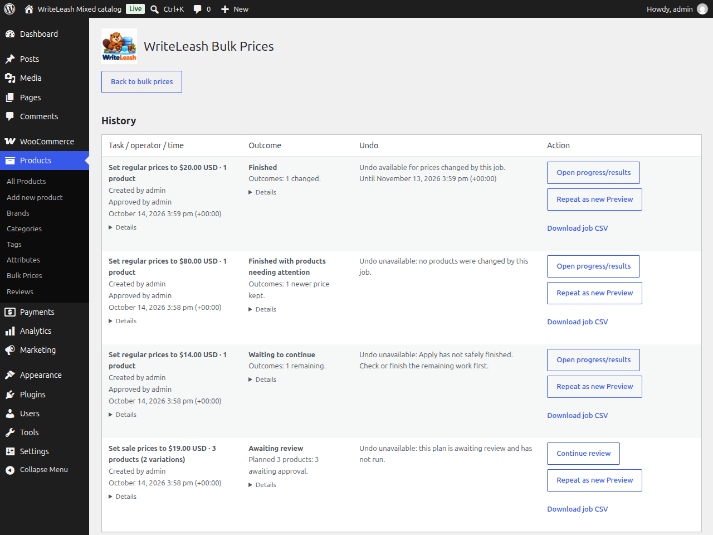
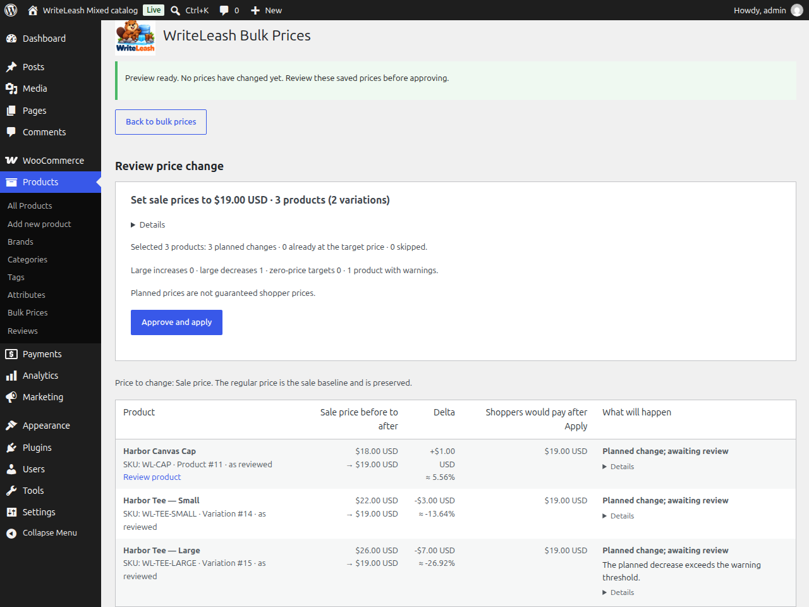
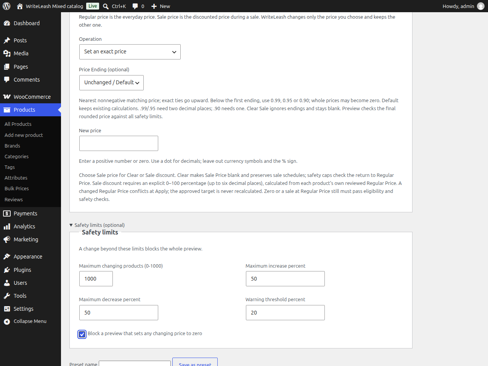

# WriteLeash for WooCommerce

**Change WooCommerce prices. Protect newer edits.**

WriteLeash for WooCommerce is the first commercial product from the broader
WriteLeash database-safety research project.

WriteLeash helps WooCommerce store owners, Shop Managers, catalog operators and
agencies change Regular Price or Sale Price across simple products and
variations. Select the products you want, Preview the exact before/after prices,
then Apply the plan you reviewed. If a relevant price or checked product setting
changes before WriteLeash reaches it, the newer edit is preserved as a conflict
instead of being overwritten.

**A newer edit wins.** The planned change here was $100 → $80, but the price had
already been changed to $120. WriteLeash leaves the $120 value alone and explains
why that product was not changed.

**Review exactly what will change.** Preview lists each product and variation
with its current price, planned price and the size of the change, so you approve
the plan you actually saw.

**Review results and recover.** History keeps each job, its outcome and which
changes are still eligible for Undo. Restoration requires Apply to finish safely,
an open Undo window and passing current-state checks. Availability does not
guarantee every price restores.

These authentic historical screenshots do not show every current control.

## Free v0.2.0 source capabilities

- **Review before you apply** — Preview shows the exact before/after price for every selected product and variation.
- **Regular Price and Sale Price** — set a price, add or subtract an amount, or increase or decrease by a percentage.
- **Simple products and variations** — select a variable product to include its variations, or choose individual variations.
- **Clear Sale and relative discounts** — clear a sale to blank or calculate a discount from reviewed Regular Price; sale dates stay unchanged.
- **Optional Price Endings** — .99, .95, .90 or whole numbers where precision permits, with final eligibility and safety checks.
- **Select by name, SKU or category** — optionally include nested subcategories; use inclusive stored Regular/Sale Price ranges.
- **Exclude individual products** — refine and review the final Preview before approval; excluded targets are absent from Apply and Undo.
- **Download Preview CSV** — inspect a frozen saved-Preview snapshot before approval, without changing prices.
- **Save Price Presets** — save, load and edit configuration, not old target prices, approval or individual exclusions. Always create a fresh Preview and approve separately; no automatic scheduling or Apply.
- **Repeat as new Preview** — with access to an eligible History job, prefill an editable operation and recalculate current eligible prices. Review and approve separately. Previously excluded targets are not silently re-added to suggestions. Repeat is not Undo, Resume or automatic retry; results may differ.
- **Up to 1,000 products per job** — in the tested configuration.
- **Live progress** — follow Apply and Undo without reloading, or return later; progress is saved.
- **Resume** — continue an interrupted job without starting over or repeating completed work.
- **History** — see what changed, what was skipped and what needs attention.
- **Eligible Undo** — restore prices WriteLeash changed while the current state still allows it; newer edits are preserved as conflicts.
- **Explained skips** — invalid or unsupported items show a reason and are skipped while clean work continues where safe.
- **Newer edits preserved** — if a relevant price or setting changed after Preview, WriteLeash shows a conflict rather than overwriting it.

Supported scope is published core simple products and published variations of
published core variable products, in the base store currency. No arbitrary
custom product types, universal extension compatibility or automatic sale
scheduling. Undo does not reverse orders, completed sales or external effects.
Back up and test on staging before a large update.

## Select → Preview → Apply

1. **Select** products by name, SKU or category and choose Regular Price or Sale Price.
2. **Preview** the exact before/after values, warnings and skipped items.
3. **Approve separately and Apply** the reviewed plan, then follow progress, History or eligible Undo.

## Install and use

1. Install and activate a supported WooCommerce version.
2. Install and activate WriteLeash.
3. Open **Products → Bulk Prices**.

Requirements, supported versions and the full capability details are in
[readme.txt](readme.txt), the WordPress.org listing source. No SSH access,
custom database account or manual SQL setup is required.

- Plugin entry point: [`writeleash.php`](writeleash.php)
- Requirements, what is supported, and current limitations: [readme.txt](readme.txt)
- License: [GPL-2.0-or-later](LICENSE)

WordPress.org approval is founder-reported. Public distribution and a usable
v0.2.0 download were not verified on 2026-10-11. This README describes merged
source functionality, not an accepted final ZIP or a live release. Release
packaging, exact-artifact testing and publication are coordinated in
[#240](https://github.com/MrDarkRoot/WriteLeash/issues/240).

## Repository research

The advanced WordPress Guard/Doctor/Redirection work is a separate research
substrate in this repository. It is not part of the WooCommerce plugin or its
package. The full technical narrative and contract links live in
[RESEARCH.md](RESEARCH.md).

Repository contribution and security policy:
[CONTRIBUTING.md](../../CONTRIBUTING.md) and [SECURITY.md](../../SECURITY.md).

## About the broader WriteLeash research

WriteLeash Research is the parent database-safety research project. Its core
thesis is **Writes consume authority.** WriteLeash for WooCommerce is its first
commercial product.

The PostgreSQL/native mutation-budget work is a separate research track. This
plugin applies related design principles — reviewed intent, bounded targets,
re-checking before mutation, preserving newer state, conflict instead of blind
overwrite, and recoverability — but it does **not** implement the
PostgreSQL/native mutation-budget mechanism and is not a database security
control.

- [Root project README](../../README.md)
- [PostgreSQL research overview](../../docs/postgresql-research.md)
- [Research support matrix](../../docs/support-matrix.md)
