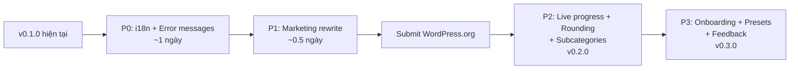

# 📋 BÁO CÁO KIỂM TOÁN TOÀN DIỆN: WriteLeash for WooCommerce v0.1.0

> **Ngày kiểm toán:** 7 tháng 10, 2026
> **Phạm vi:** `wordpress/writeleash/` — WordPress plugin product
> **Phương pháp:** 4 auditor chuyên môn song song (Code Quality, Marketing, Compliance, UX)

---

## 🎯 TỔNG QUAN NHANH

```
┌─────────────────────────────┬──────────┬───────────────────────────────────────┐
│ Chiều đánh giá              │ Điểm     │ Nhận định                             │
├─────────────────────────────┼──────────┼───────────────────────────────────────┤
│ 🔒 Code Quality & Security │ 8.5/10   │ Enterprise-grade, xuất sắc            │
│ ✅ WP.org Compliance        │ 7.0/10   │ Đạt hầu hết, thiếu i18n              │
│ 📢 Marketing & Sales Copy  │ 3.0/10   │ Viết như luận văn, không bán hàng     │
│ 🎨 UX & Product Gaps       │ 4.0/10   │ Công cụ nội bộ, chưa phải sản phẩm   │
├─────────────────────────────┼──────────┼───────────────────────────────────────┤
│ TỔNG ĐIỂM TRUNG BÌNH       │ 5.6/10   │ Lõi kỹ thuật đỉnh, vỏ cần đại tu    │
└─────────────────────────────┴──────────┴───────────────────────────────────────┘
```

> [!IMPORTANT]
> **Kết luận 1 câu:** WriteLeash có engine xử lý giá **an toàn nhất** trong hệ sinh thái WooCommerce (InnoDB row locking, optimistic concurrency, SHA256 fingerprint undo), nhưng đang bị bọc trong lớp vỏ marketing và UX của một **bài báo nghiên cứu** thay vì một **sản phẩm thương mại**.

---

## 📊 BẢNG SCORECARD CHI TIẾT

### 🔒 A. CODE QUALITY & SECURITY — 8.5/10

| # | Hạng mục | Kết quả | Mức độ | Ghi chú |
|---|----------|---------|--------|---------|
| 1 | Nonce verification (CSRF) | ✅ PASS | — | 5 điểm mutation đều có `wp_verify_nonce()`, nonce gắn kèm object ID |
| 2 | Sanitization & Escaping | ✅ PASS | — | 118 lệnh `esc_html/esc_attr/esc_url`, mọi `$_POST` đều unslash + validate |
| 3 | Capability checks | ✅ PASS | — | `manage_woocommerce` + `edit_products` + `edit_post($id)` |
| 4 | Asset isolation | ✅ PASS | — | CSS/JS chỉ load trên 3 hook screens hợp lệ |
| 5 | Debug code leakage | ✅ PASS | — | Không có `error_log`, `var_dump`, `print_r`, `die()` trần |
| 6 | TODO/FIXME markers | ✅ PASS | — | Zero markers — code sạch |
| 7 | Lifecycle management | ✅ PASS | — | Activation/deactivation/uninstall đều fail-closed |
| 8 | Direct DB access | ✅ PASS | — | Chỉ 2 lệnh `$wpdb` để check schema readiness |
| 9 | CSV Formula Injection | ✅ PASS | — | Có cơ chế chống injection trong export |
| 10 | **i18n (Internationalization)** | ❌ FAIL | **HIGH** | 0 lệnh `__()` hoặc `esc_html__()` trong toàn bộ codebase |
| 11 | **File size / SRP** | ⚠️ WARN | MEDIUM | `class-free-admin.php` = 1,653 dòng, gom menu + handler + render + export |
| 12 | **JS i18n** | ⚠️ WARN | LOW | Chuỗi UI trong JS hardcode English, chưa dùng `wp.i18n` |

---

### ✅ B. WORDPRESS.ORG COMPLIANCE — 7.0/10

| # | Hạng mục | Kết quả | Ghi chú |
|---|----------|---------|---------|
| 1 | readme.txt headers | ✅ PASS | Đầy đủ, khớp plugin header |
| 2 | Version alignment | ✅ PASS | `Stable tag` = `Version` = `WRITELEASH_VERSION` = `0.1.0` |
| 3 | Required sections | ✅ PASS | Description, Installation, FAQ, Screenshots, Changelog ✓ |
| 4 | License | ✅ PASS | GPLv2 verbatim |
| 5 | Assets dimensions | ✅ PASS | icon 128×128, 256×256; banner 772×250, 1544×500 ✓ |
| 6 | No external HTTP calls | ✅ PASS | Zero `wp_remote_*`, `curl`, phone-home |
| 7 | No telemetry/tracking | ✅ PASS | Hoàn toàn sạch |
| 8 | No upsell nag screens | ✅ PASS | Đầy đủ tính năng, không quảng cáo Pro |
| 9 | No obfuscated code | ✅ PASS | JS/CSS ở dạng source, không minify |
| 10 | No trademark violations | ✅ PASS | Tên "WriteLeash" không vi phạm |
| 11 | Distribution manifest | ✅ PASS | 37 file allowlist, không lẫn test/docs |
| 12 | **i18n compliance** | ❌ FLAG | Có `Text Domain` nhưng 0 translatable strings |
| 13 | **Build script outdated** | ⚠️ WARN | SHA pinned cũ + assertion `11.1.2` bị lệch |
| 14 | **WP version headers** | ⚠️ NOTE | `Requires at least: 7.0` — WP 7.x chưa ra (đây là lab environment) |

> [!WARNING]
> **Rủi ro từ chối (Rejection Risk):** Thấp. WordPress.org Plugin Review Team **không bắt buộc** i18n để accept, nhưng thường **yêu cầu bổ sung** trong vòng review đầu tiên. Các rejection reasons phổ biến (external calls, tracking, obfuscation, sanitization) đều PASS tuyệt đối.

---

### 📢 C. MARKETING & SALES COPY — 3.0/10

| Tiêu chí | Điểm | Vấn đề |
|----------|-------|--------|
| Short Description | 3/10 | 61/150 ký tự, dùng thuật ngữ "blindly overwriting newer edits" |
| SEO Tags | 4/10 | `safety` và `undo` không ai tìm kiếm; thiếu `bulk price`, `sale price`, `price editor` |
| Description body | 3.5/10 | 100% liệt kê tính năng + rào đón trách nhiệm, 0% lợi ích kinh doanh |
| FAQ tone | 2/10 | "Real managed or shared hosting has not been tested" = tự sát thương mại |
| Error messages | 2/10 | "decimal contract", "mutations", "actor", "evidence", "material mismatch" |
| Screenshots | 3.5/10 | Dữ liệu test UUID thô kệch, không có demo thực tế |
| GitHub README | 4/10 | Lẫn PostgreSQL research vào product page |
| Changelog | 6/10 | OK nhưng nhiễm "in the tested configuration" |
| **i18n** | **0/10** | **Zero translatable strings — CRITICAL** |

#### Đề xuất cụ thể:

**Short Description (viết lại):**
```
Hiện tại: "Bulk price changes without blindly overwriting newer edits." (61 chars)
Đề xuất:  "Safe WooCommerce bulk price editor with live preview & 1-click undo.
           Update regular & sale prices without breaking newer edits." (148 chars)
```

**Tags (thay thế):**
```
Hiện tại: woocommerce, bulk edit, prices, undo, safety
Đề xuất:  bulk edit, bulk price, sale price, price editor, woocommerce
```

**Changelog (viết lại):**
```markdown
= 0.1.0 =
* Initial public release.
* Bulk update Regular & Sale prices for simple and variable products.
* Live before-and-after Preview before applying changes.
* Concurrency protection: preserves newer edits.
* Background batch processing with Resume and full Job History.
* 1-Click Undo for eligible price updates.
```

---

### 🎨 D. UX & PRODUCT GAPS — 4.0/10

#### D1. Điểm nghẽn UX lớn nhất (Top 5 Pain Points)

| # | Pain Point | Mức độ | Mô tả |
|---|-----------|--------|--------|
| 1 | **Không có live progress** | HIGH | Job chạy nền nhưng UI đứng yên — phải bấm F5 liên tục |
| 2 | **Thuật ngữ kỹ sư** | HIGH | "unsigned decimal amount string", "decimal contract", Plan Hash SHA-256 |
| 3 | **Category chỉ chọn 1, không có subcategories** | HIGH | Chọn "Thời trang" nhưng "Thời trang > Áo thun" bị bỏ qua |
| 4 | **Không có price rounding (.99)** | MEDIUM | Giảm 15% ra $16.9915 — shop muốn $16.99 hoặc $17.00 |
| 5 | **Preview không cho sửa inline** | MEDIUM | Muốn gỡ 1 sản phẩm phải quay lại từ đầu |

#### D2. So sánh với đối thủ

| Tính năng | PW / BEAR / Smart Manager | WriteLeash |
|-----------|--------------------------|------------|
| Spreadsheet inline edit | ✅ | ❌ |
| Price rounding (.99, .95) | ✅ | ❌ |
| Scheduled sales (set dates) | ✅ | ❌ |
| Multi-category + subcategories | ✅ | ❌ (1 category, direct only) |
| Filter by tag/stock/attribute/price range | ✅ | ❌ |
| Edit title/SKU/stock/weight/status | ✅ | ❌ (chỉ giá) |
| Live progress bar | ✅ | ❌ (phải F5) |
| Scale > 1000 products | ✅ | ❌ (giới hạn cứng 1000) |
| **Preview before apply** | ❌ | ✅ **Unique** |
| **Conflict protection** | ❌ | ✅ **Unique** |
| **Safe Undo** | ❌ | ✅ **Unique** |
| **Resume interrupted jobs** | ❌ | ✅ **Unique** |

> [!TIP]
> **Lợi thế cạnh tranh không ai có (Moat):** Preview → Conflict Protection → Safe Undo → Resume. Đây là 4 tính năng an toàn mà **không plugin nào khác** trong hệ sinh thái WooCommerce cung cấp. Đối thủ đều ghi đè thô bạo (blind overwrite).

#### D3. Onboarding & Settings

- **Welcome wizard:** Không có
- **Guided tour:** Không có
- **Settings page:** Không có (Safety limits nhập lại mỗi job)
- **Empty state:** 1 dòng text đơn sơ
- **Deactivation feedback:** Không có
- **Review prompt:** Không có
- **Analytics/Telemetry:** Không có (hoàn toàn "mù" về hành vi user)

#### D4. Edge Cases — Xử lý xuất sắc

| Tình huống | Kết quả |
|-----------|---------|
| Server timeout mid-job | ✅ Fenced lease + auto PAUSED + Resume button |
| WooCommerce deactivated | ✅ Graceful degradation, no fatal error |
| 0 products selected | ⚠️ An toàn nhưng UX vụng (cho tạo Plan rỗng) |
| Concurrent admin edits | ✅ Phát hiện xung đột, bảo vệ giá mới hơn |
| Plugin uninstall | ✅ Fail-closed, giữ journal/undo data cho audit |

---

## 🚀 HÀNH ĐỘNG ƯU TIÊN (ACTION MATRIX)

### 🔴 P0 — Làm ngay trước khi submit WordPress.org

| # | Hành động | Effort | Impact |
|---|-----------|--------|--------|
| 1 | **i18n: Bọc toàn bộ chuỗi UI bằng `esc_html__()`/`__()`** | ~4-6h | Tuân thủ WP standards, mở cửa cho dịch thuật |
| 2 | **Gọi `load_plugin_textdomain('writeleash')`** | 10 min | Kích hoạt i18n framework |
| 3 | **JS strings: dùng `wp_localize_script()` hoặc `wp.i18n`** | ~1h | JS translatable |
| 4 | **Viết lại error messages thân thiện merchant** | ~2h | "decimal contract" → "invalid price format" |

### 🟡 P1 — Làm trước khi launch marketing

| # | Hành động | Effort | Impact |
|---|-----------|--------|--------|
| 5 | **Viết lại Short Description (148 chars)** | 15 min | SEO + first impression |
| 6 | **Đổi 5 SEO Tags** | 5 min | Tăng discoverability |
| 7 | **Viết lại Description bán lợi ích** | ~1h | Conversion rate |
| 8 | **Viết lại FAQ bằng ngôn ngữ merchant** | ~1h | Xóa sợ hãi hosting |
| 9 | **Chụp lại screenshots với data thực tế** | ~1h | Professional appearance |
| 10 | **Cập nhật build script (SHA + assertion)** | 30 min | Build pipeline hoạt động |

### 🟢 P2 — Phiên bản kế tiếp (v0.2.0)

| # | Hành động | Effort | Impact |
|---|-----------|--------|--------|
| 11 | **AJAX live progress bar** | ~4h | Xóa pain point #1 |
| 12 | **Price rounding rules (.99, .95, nearest)** | ~3h | Tính năng sống còn cho retail |
| 13 | **Subcategories + multi-category selection** | ~2h | Xóa pain point #3 |
| 14 | **Link "Edit Product" trong bảng lỗi** | ~30 min | Actionable errors |
| 15 | **Tách `class-free-admin.php` (1653 LOC)** | ~3h | Maintainability |

### 🔵 P3 — Growth features (v0.3.0+)

| # | Hành động | Effort | Impact |
|---|-----------|--------|--------|
| 16 | Onboarding wizard / first-use tour | ~4h | Adoption |
| 17 | Campaign presets (1-click: "Flash Sale -20%") | ~3h | Speed-to-value |
| 18 | Deactivation feedback modal | ~1h | User insight |
| 19 | Review prompt after successful job | ~30 min | WordPress.org ratings |
| 20 | Settings page (persistent safety limits) | ~2h | Convenience |

---

## 📈 LỘ TRÌNH ĐỀ XUẤT



---

## 💡 NHẬN ĐỊNH CUỐI CÙNG

WriteLeash đang ở trạng thái **"engine Ferrari bọc trong vỏ xe tải"**:

- **Engine (8.5/10):** Transaction safety, concurrency control, fenced lease workers, deterministic decimal math, SHA256 fingerprint undo — đây là kiến trúc cấp enterprise mà không plugin WooCommerce nào khác có.

- **Vỏ xe (3.5/10):** Marketing viết như luận văn tiến sĩ, error messages dùng thuật ngữ database internals, screenshots chứa test fixtures, FAQ hù dọa người dùng shared hosting, UI thiếu live feedback.

**Solo developer nên tập trung vào:** P0 (i18n + error messages) → P1 (marketing rewrite) → Submit → rồi iterate P2/P3 dựa trên user feedback thực tế. Đừng cố hoàn hảo mọi thứ trước khi ship — lợi thế cạnh tranh (Preview + Conflict Protection + Undo + Resume) đã đủ mạnh để khác biệt trên thị trường.
